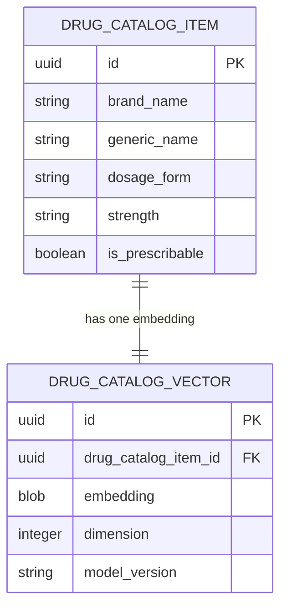

# Data Model: Tier-2 Local Neural Fallback

**Feature Branch**: `004-tier2-local-neural-fallback` | **Date**: 2026-10-15

---

## 1. Entities & Schema Definitions

### `DrugCatalogVector`

Represents the pre-computed 256-dimension normalized embedding for a verified DGDA medication record.

- **Storage Format**: Relational SQLite table with BLOB embedding storage alongside an optional `vec0` virtual table for environments with `sqlite-vec` shared library loaded.
- **Dimensionality**: Strictly 256 dimensions (MRL prefix slice from EmbeddingGemma 2 270M).
- **Binary Footprint**: 256 floats × 4 bytes (IEEE 754 single-precision float32 little-endian) = **1,024 bytes per record**.

#### Schema (`priv/repo/migrations/20261015160000_create_drug_catalog_vectors.exs`)

```sql
CREATE TABLE drug_catalog_vectors (
  id TEXT PRIMARY KEY NOT NULL,
  drug_catalog_item_id TEXT NOT NULL,
  embedding BLOB NOT NULL,
  dimension INTEGER NOT NULL DEFAULT 256 CHECK (dimension = 256),
  model_version TEXT NOT NULL,
  inserted_at TEXT NOT NULL,
  updated_at TEXT NOT NULL,
  FOREIGN KEY (drug_catalog_item_id) REFERENCES drug_catalog (id) ON DELETE CASCADE
);

CREATE UNIQUE INDEX drug_catalog_vectors_item_id_idx
  ON drug_catalog_vectors (drug_catalog_item_id);

CREATE INDEX drug_catalog_vectors_version_idx
  ON drug_catalog_vectors (model_version);
```

#### Optional `sqlite-vec` Virtual Table Schema (`vec0`)

When the `sqlite-vec` dynamic extension is loaded, the pre-computation pipeline mirrors embeddings into a virtual table for SIMD cosine distance indexing:

```sql
CREATE VIRTUAL TABLE IF NOT EXISTS drug_catalog_vec_vtab USING vec0(
  drug_catalog_item_id TEXT PRIMARY KEY,
  embedding float[256] distance_metric=cosine
);
```

---

## 2. Fields & Type Mappings

| Field | Storage Type | Elixir / Ash Type | Constraints & Validation | Description |
| :--- | :--- | :--- | :--- | :--- |
| `id` | `TEXT` (UUID) | `:uuid` | Primary Key, UUIDv4 | Unique vector record identifier |
| `drug_catalog_item_id` | `TEXT` (UUID) | `:uuid` | Required, Unique, Foreign Key (`drug_catalog.id`) | Foreign key linking to verified DGDA item |
| `embedding` | `BLOB` | `:binary` | Required, length = 1024 bytes (`256 * 4`) | L2-normalized IEEE 754 single-precision float32 array |
| `dimension` | `INTEGER` | `:integer` | Required, strictly `256` | Checked constraint for MRL dimensional invariance |
| `model_version` | `TEXT` | `:string` | Required, e.g. `"embedding_gemma_2_270m_mrl256"` | Tracks model revision for deterministic invalidation |
| `inserted_at` | `TEXT` | `:utc_datetime_usec` | ISO 8601 UTC timestamp | Record creation timestamp |
| `updated_at` | `TEXT` | `:utc_datetime_usec` | ISO 8601 UTC timestamp | Record modification timestamp |

---

## 3. Relationships & Foreign Key Enforcements



- **One-to-One Integrity**: Each `DrugCatalogItem` has at most one active `DrugCatalogVector`. A unique index on `drug_catalog_item_id` prevents duplicate embeddings.
- **Cascade Deletion**: If a DGDA catalog item is removed, its associated vector is automatically purged (`ON DELETE CASCADE`).
- **Referential Whitelist**: Vectors can only reference valid `DrugCatalogItem` records that are active and prescribable (`is_prescribable: true`).

---

## 4. Ash Resource Definition (`RxGenerator.Formulary.DrugCatalogVector`)

```elixir
defmodule RxGenerator.Formulary.DrugCatalogVector do
  use Ash.Resource,
    domain: RxGenerator.Formulary,
    data_layer: AshSqlite.DataLayer

  sqlite do
    table "drug_catalog_vectors"
    repo RxGenerator.Repo
  end

  attributes do
    uuid_primary_key :id

    attribute :embedding, :binary do
      allow_nil? false
      description "1024-byte binary of 256 float32 values"
    end

    attribute :dimension, :integer do
      allow_nil? false
      default 256
    end

    attribute :model_version, :string do
      allow_nil? false
      default "embedding_gemma_2_270m_mrl256"
    end

    create_timestamp :inserted_at
    update_timestamp :updated_at
  end

  relationships do
    belongs_to :drug_catalog_item, RxGenerator.Formulary.DrugCatalogItem do
      allow_nil? false
      attribute_writable? true
    end
  end

  validations do
    validate fn changeset, _context ->
      case Ash.Changeset.get_attribute(changeset, :embedding) do
        nil ->
          :ok

        binary when is_binary(binary) and byte_size(binary) == 1024 ->
          :ok

        binary when is_binary(binary) ->
          {:error, field: :embedding, message: "must be exactly 1024 bytes (256 float32 values)"}

        _ ->
          {:error, field: :embedding, message: "must be a binary blob"}
      end
    end
  end

  actions do
    defaults [:read, :destroy]

    create :create do
      primary? true
      accept [:drug_catalog_item_id, :embedding, :dimension, :model_version]
    end

    update :update do
      primary? true
      accept [:embedding, :dimension, :model_version]
    end
  end
end
```

---

## 5. Dosage Form Constraint Matrix

To fulfill User Story 2 (Formulation Mismatch Protection) and Constitution Article VII, candidate vectors retrieved via cosine distance are constrained by dosage form.

The query pipeline matches canonical dosage forms:

| Shorthand Token | Canonical DB Value (`c.dosage_form`) | Example Brand Resolution |
| :--- | :--- | :--- |
| `tab`, `tablet`, `tabs` | `"Tablet"` | Aceclofenac 100mg Tablet |
| `syr`, `syrup`, `susp` | `"Syrup"` | Paracetamol 120mg/5ml Syrup |
| `cap`, `capsule`, `caps` | `"Capsule"` | Omeprazole 20mg Capsule |
| `inj`, `injection` | `"Injection"` | Ceftriaxone 1g Injection |
| `supp`, `suppository` | `"Suppository"` | Diclofenac 12.5mg Suppository |
| `drop`, `drops` | `"Drop"` | Ciprofloxacin 0.3% Eye/Ear Drops |
| `cream`, `cr`, `oint` | `"Cream"` / `"Ointment"` | Hydrocortisone 1% Cream |

---

## 6. Mathematical Invariants & Validation Rules

1. **Dimensional Invariance**:
   $$\text{len}(\vec{v}) = 256$$
   Any tensor produced with length $\ne 256$ is rejected before persistence.
2. **L2-Norm Normalization**:
   $$\|\vec{v}\|_2 = \sqrt{\sum_{i=1}^{256} v_i^2} = 1.0 \pm 10^{-4}$$
   Because all catalog and query vectors are unit-normalized upon ingestion, cosine distance simplifies to:
   $$\text{cosine\_distance}(\vec{u}, \vec{v}) = 1.0 - (\vec{u} \cdot \vec{v})$$
   $$\text{cosine\_similarity}(\vec{u}, \vec{v}) = \vec{u} \cdot \vec{v}$$
3. **Similarity Threshold Floor**:
   $$\text{cosine\_similarity}(\vec{q}, \vec{d}) \ge 0.65$$
   Any candidate scoring below 0.65 is pruned as semantic noise.
