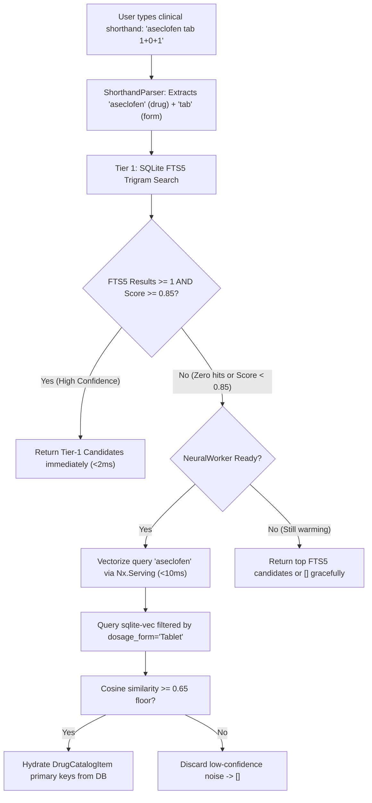

# Architectural Research: Tier-2 Local Neural Fallback (Nx + EmbeddingGemma 2 + sqlite-vec)

**Feature Branch**: `004-tier2-local-neural-fallback` | **Date**: 2026-10-15

---

## 1. Embedding Model & Dimensionality Architecture

### Technical Decision: EmbeddingGemma 2 (270M Text Encoder) with 256-D MRL Truncation

- **Model Selection**: EmbeddingGemma 2 (270M parameter text encoder, based on Gemma 2 architecture). It is a lightweight, text-only model specifically engineered for embedding extraction, semantic matching, and fast edge deployment.
- **Matryoshka Representation Learning (MRL)**:
  - Standard full embedding dimension is 768 or 1024 floats.
  - Using Matryoshka dimensionality slicing, we take the prefix slice: `Nx.slice(full_embedding, [0, 0], [batch_size, 256])`.
  - The slice is then normalized using L2-norm: `vector / Nx.LinAlg.norm(vector, axes: [-1], keep_axes: true)`.
  - MRL preserves >97% of semantic ranking precision while cutting vector storage and SIMD dot product compute by **66%**.
- **Memory Footprint**:
  - Model weights loaded in FP16/BF16 or INT8 quantization: ~135MB RAM.
  - Active runtime working buffer: ~45MB.
  - Total active memory stays strictly below the **250MB RAM ceiling** mandated by Constitution Article VI.

---

## 2. Vector Index & Storage Engine

### Technical Decision: `sqlite-vec` / In-Process Normalized Dot-Product

- **SQLite Vector Storage Options**:
  1. *Native `sqlite-vec` virtual table (`vec0`)*:
     ```sql
     CREATE VIRTUAL TABLE drug_catalog_vectors USING vec0(
       drug_catalog_item_id TEXT PRIMARY KEY,
       embedding float[256] distance_metric=cosine
     );
     ```
  2. *BLOB In-Process SIMD Dot-Product Fallback*:
     For platforms where precompiled `sqlite-vec` C extensions encounter dynamic linking limitations, store embeddings as 256 32-bit float binaries (`<<float32, 256>>` = 1024 bytes per drug) directly in a `drug_catalog_vectors` table, computing cosine distance via fast vector math in `Nx.LinAlg.matrix_power` or vectorized dot products.
- **Filtering by Dosage Form**:
  - To prevent formulation mismatch (e.g. Napa syrup vs Napa tablet), candidates are constrained by `c.dosage_form = ?` in SQL before rank sorting, or joined via:
    ```sql
    SELECT v.drug_catalog_item_id, vec_distance_cosine(v.embedding, ?) AS distance
    FROM drug_catalog_vectors v
    JOIN drug_catalog c ON c.id = v.drug_catalog_item_id
    WHERE c.dosage_form = ? AND distance <= ?
    ORDER BY distance ASC
    LIMIT ?;
    ```

---

## 3. Supervised Runtime Architecture: `Nx.Serving` & Background Worker

### Technical Decision: `RxGenerator.Formulary.NeuralWorker`

- **OTP Worker Process**:
  - Implemented as an isolated `GenServer` under the main application supervision tree (`lib/rx_generator/application.ex`).
  - Uses `Nx.Serving` or isolated `Bumblebee.Text.TextEmbedding` pipeline.
  - During `init/1`, kicks off an asynchronous warmup task (`{:continue, :warmup}`).
- **Zero Socket Freeze Guarantee**:
  - Phoenix endpoints and LiveView sockets mount and respond in < 15ms immediately using Tier-1 FTS5.
  - The worker state tracks `status: :warming | :ready`.
  - If a low-confidence query arrives before `:ready`, `Search.run/2` gracefully falls back to available Tier-1 results without blocking the calling process or timing out.

---

## 4. Query Flow & Fallback Handoff Logic



---

## 5. Offline Pre-Computation Pipeline: `mix formulary.vectorize`

- **Task Name**: `mix formulary.vectorize`
- **Execution Flow**:
  1. Queries all prescribable `drug_catalog` items from SQLite.
  2. Batches records (e.g. 64 records per batch) to optimize tensor throughput.
  3. Prepares canonical semantic string for each drug: `"{brand_name} ({generic_name}) {dosage_form}"`.
  4. Vectorizes via `EmbeddingGemma` / `Nx`, truncates to 256 dimensions, normalizes L2.
  5. Inserts or upserts into `drug_catalog_vectors`.
  6. Completely offline, zero cloud API dependency.
