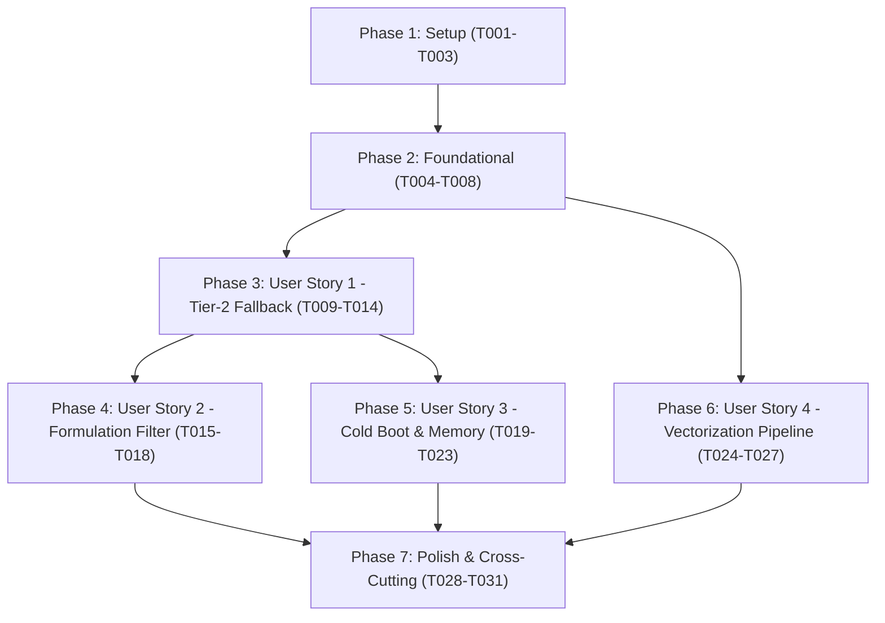

# Tasks: Tier-2 Local Neural Fallback (Nx + EmbeddingGemma 2 + sqlite-vec)

**Branch**: `004-tier2-local-neural-fallback` | **Date**: 2026-10-18 | **Spec**: [Feature Specification](file:///d:/Rx_generator/specs/004-tier2-local-neural-fallback/spec.md) | **Plan**: [Implementation Plan](file:///d:/Rx_generator/specs/004-tier2-local-neural-fallback/plan.md)

---

## Phase 1: Setup (Shared Infrastructure)

**Purpose**: Project initialization, neural dependencies, and test double configuration.

- [x] T001 Add neural runtime dependencies `{:nx, "~> 0.9"}`, `{:bumblebee, "~> 0.6"}`, and `{:exla, "~> 0.9"}` to `mix.exs`
- [x] T002 Configure EXLA / Nx default backend and bundled model path `"priv/models/embedding_gemma_2"` in `config/config.exs` and `config/test.exs`
- [x] T003 [P] Implement deterministic test double backend in `test/support/test_neural_backend.ex` generating reproducible 256-D float32 vectors for fast offline test execution

---

## Phase 2: Foundational (Blocking Prerequisites)

**Purpose**: Core vector storage, database migration, and low-level similarity calculation that MUST be complete before ANY user story can be implemented.

**⚠️ CRITICAL**: No user story work can begin until this phase is complete.

- [x] T004 Create database migration in `priv/repo/migrations/20261015160000_create_drug_catalog_vectors.exs` defining table `drug_catalog_vectors` with columns `id TEXT PRIMARY KEY NOT NULL`, `drug_catalog_item_id TEXT NOT NULL REFERENCES drug_catalog(id) ON DELETE CASCADE`, `embedding BLOB NOT NULL`, `dimension INTEGER NOT NULL DEFAULT 256 CHECK (dimension = 256)`, `model_version TEXT NOT NULL`, and unique index `drug_catalog_vectors_item_id_idx ON drug_catalog_vectors(drug_catalog_item_id)`
- [x] T005 [P] Implement `DrugCatalogVector` Ash resource in `lib/rx_generator/formulary/drug_catalog_vector.ex` with attribute `:embedding` validated as `"must be exactly 1024 bytes (256 float32 values)"`, `:dimension` defaulting to `256`, `:model_version` defaulting to `"embedding_gemma_2_270m_mrl256"`, and `belongs_to :drug_catalog_item`
- [x] T006 Register `DrugCatalogVector` resource in `lib/rx_generator/formulary.ex` domain definition
- [x] T007 Implement vector storage query module in `lib/rx_generator/formulary/vector_store.ex` supporting cosine distance search over 1024-byte float32 blobs via SQLite queries and `Nx.dot/2` SIMD fallback
- [x] T008 [P] Write unit tests in `test/rx_generator/formulary/vector_store_test.exs` asserting 256-D cosine similarity calculations, top-K ranking, and empty candidate handling

**Checkpoint**: Foundation ready - vector table and low-level similarity store operational.

---

## Phase 3: User Story 1 - Automatic Tier-2 Semantic Fallback (Priority: P1) 🎯 MVP

**Goal**: Automatically trigger Tier-2 local vector search when Tier-1 SQLite FTS5 returns zero results or low confidence (< 0.85), returning exact verified DGDA primary keys in under 15ms.

**Independent Test**: Execute `mix test test/rx_generator/formulary/search_tier2_test.exs` asserting phonetic typo queries (`"aseclo"`, `"siproflox"`, `"paracitamol"`) return valid `DrugCatalogItem` structs with cosine similarity $\ge 0.65$ within 15ms, while high-confidence FTS5 queries bypass Tier-2.

### Tests for User Story 1 (Strict TDD Red-First) ⚠️

> **NOTE: Write these tests FIRST, ensure they FAIL before implementation**

- [ ] T009 [P] [US1] Write test in `test/rx_generator/formulary/search_tier2_test.exs` asserting that `Search.run("aseclofen")` invokes Tier-2 vector fallback when Tier-1 FTS5 returns 0 matches and returns exact `DrugCatalogItem` records in under 15ms
- [ ] T010 [P] [US1] Write test in `test/rx_generator/formulary/search_tier2_test.exs` asserting that clean queries with high FTS5 confidence ($\ge 0.85$) bypass Tier-2 vectorization completely in sub-2ms

### Implementation for User Story 1

- [ ] T011 [US1] Implement query vectorization API in `lib/rx_generator/formulary/neural_worker.ex` returning `{:ok, <<float32, 256>>}` L2-normalized 1024-byte binary embedding truncated to 256 dimensions via Matryoshka slicing
- [ ] T012 [US1] Update `RxGenerator.Formulary.Search.run/2` in `lib/rx_generator/formulary/search.ex` to check FTS5 match confidence and trigger `VectorStore.search/2` fallback when hits == 0 or confidence score < 0.85
- [ ] T013 [US1] Implement deterministic candidate hydration in `lib/rx_generator/formulary/search.ex` ensuring 100% of returned items resolve to verified `drug_catalog` primary keys with zero generative text output (Article I)
- [ ] T014 [US1] Enforce cosine similarity threshold floor of 0.65 in `lib/rx_generator/formulary/search.ex` pruning low-confidence nearest-neighbor noise

**Checkpoint**: User Story 1 complete and independently testable as MVP.

---

## Phase 4: User Story 2 - Formulation Mismatch Protection (Priority: P1)

**Goal**: Filter Tier-2 semantic vector search candidates strictly by clinical dosage form hints (`Tab`, `Syr`, `Cap`, `Inj`), preventing lethal formulation mismatches (e.g., adult tablets when pediatric syrup is intended).

**Independent Test**: Execute `mix test test/rx_generator/formulary/formulation_filter_test.exs` asserting that `Search.run("paracitamol", form: :syr)` returns 100% Syrup candidates and zero Tablet candidates.

### Tests for User Story 2 (Strict TDD Red-First) ⚠️

- [ ] T015 [P] [US2] Write tests in `test/rx_generator/formulary/formulation_filter_test.exs` asserting that `Search.run/2` with `:syr`, `:tab`, `:cap`, and `:inj` hints strictly filters candidate vectors by `c.dosage_form`
- [ ] T016 [P] [US2] Write tests in `test/rx_generator/formulary/formulation_filter_test.exs` asserting that queries without dosage form hints return matches across all forms, and unrecognized form hints fall back safely without raising exceptions

### Implementation for User Story 2

- [ ] T017 [US2] Implement dosage form SQL filtering in `lib/rx_generator/formulary/vector_store.ex` joining `drug_catalog` on `v.drug_catalog_item_id = c.id` with `WHERE (? IS NULL OR c.dosage_form = ?)`
- [ ] T018 [US2] Integrate `normalize_form/1` in `lib/rx_generator/formulary/search.ex` to extract form tokens from shorthand queries and pass canonical form strings (`"Tablet"`, `"Syrup"`, `"Capsule"`, `"Injection"`) to `VectorStore.search/2`

**Checkpoint**: User Stories 1 AND 2 both work and are independently testable.

---

## Phase 5: User Story 3 - Air-Gapped Cold-Boot & Bounded Memory Enforcement (Priority: P2)

**Goal**: Ensure the inference engine warms up asynchronously in the background via OTP supervision (`{:continue, :warmup}`) without freezing LiveView socket mount (<15ms), while system RAM remains strictly under 250MB.

**Independent Test**: Execute `mix test test/rx_generator/formulary/neural_worker_lifecycle_test.exs` asserting LiveView socket mount time < 15ms during startup, non-blocking fallback while status is `:warming`, and active RAM < 250MB.

### Tests for User Story 3 (Strict TDD Red-First) ⚠️

- [ ] T019 [P] [US3] Write tests in `test/rx_generator/formulary/neural_worker_lifecycle_test.exs` asserting asynchronous warm-up via `{:continue, :warmup}`, transition from `:warming` to `:ready`, and non-blocking query handling during warm-up
- [ ] T020 [P] [US3] Write memory benchmark test in `test/rx_generator/formulary/memory_benchmark_test.exs` asserting `:erlang.memory(:total)` remains strictly below 250MB under 10 concurrent autocomplete requests (Article VI)

### Implementation for User Story 3

- [ ] T021 [US3] Implement `RxGenerator.Formulary.NeuralWorker` GenServer lifecycle in `lib/rx_generator/formulary/neural_worker.ex` using `{:continue, :warmup}` for asynchronous model loading and EXLA JIT graph compilation
- [ ] T022 [US3] Add `RxGenerator.Formulary.NeuralWorker` to supervision tree in `lib/rx_generator/application.ex` configured with bundled local weights
- [ ] T023 [US3] Implement non-blocking fallback in `lib/rx_generator/formulary/search.ex` when `NeuralWorker.status()` returns `:warming`, returning available Tier-1 results immediately without blocking the caller process

**Checkpoint**: Cold-boot mitigation and RAM ceiling adherence fully enforced.

---

## Phase 6: User Story 4 - Pre-Computed Embedding Pipeline & Vector Store Migration (Priority: P2)

**Goal**: Provide an offline Mix task (`mix formulary.vectorize`) to pre-compute and persist 256-D normalized embeddings for all prescribable DGDA catalog items into `drug_catalog_vectors`.

**Independent Test**: Execute `mix test test/mix/tasks/formulary_vectorize_test.exs` asserting that running `mix formulary.vectorize` populates `drug_catalog_vectors` with exactly 1024-byte float32 blobs for each prescribable catalog item.

### Tests for User Story 4 (Strict TDD Red-First) ⚠️

- [ ] T024 [P] [US4] Write unit tests in `test/rx_generator/formulary/ingestion/vectorizer_test.exs` asserting canonical semantic string formatting `"{brand_name} ({generic_name}) {dosage_form}"`, 256-D MRL prefix truncation, and L2 normalization
- [ ] T025 [P] [US4] Write integration test in `test/mix/tasks/formulary_vectorize_test.exs` asserting `mix formulary.vectorize` populates `drug_catalog_vectors` with dimension 256 and byte_size 1024

### Implementation for User Story 4

- [ ] T026 [US4] Implement catalog embedding generator in `lib/rx_generator/formulary/ingestion/vectorizer.ex` with batched Nx inference (batch size 64) and MRL 256-D prefix slicing (`Nx.slice/3` + `Nx.LinAlg.norm/2`)
- [ ] T027 [US4] Implement CLI Mix task in `lib/mix/tasks/formulary.vectorize.ex` supporting `--batch-size`, `--force`, and `--quiet` flags with transactional upsert into `drug_catalog_vectors`

**Checkpoint**: Catalog vectorization pipeline fully operational.

---

## Phase 7: Polish & Cross-Cutting Concerns

**Purpose**: End-to-end integration, air-gapped security audits, and High Court formatting compliance.

- [ ] T028 [P] Write air-gapped network isolation audit test in `test/rx_generator/formulary/airgap_audit_test.exs` verifying zero outbound network calls during vector inference and search (Article V)
- [ ] T029 [P] Write LiveView omnibar integration test in `test/rx_generator_web/live/prescription_live/omnibar_tier2_test.exs` verifying phonetic shorthand typos in the UI omnibar resolve to DGDA catalog items with uppercase generic names (Article II)
- [ ] T030 Execute quickstart validation scenarios per `specs/004-tier2-local-neural-fallback/quickstart.md`
- [ ] T031 Run `mix precommit` to verify compilation with zero warnings, format checks, and 100% test pass rate

---

## Dependencies & Execution Order

### Phase Dependencies



- **Setup (Phase 1)**: No dependencies - can start immediately.
- **Foundational (Phase 2)**: Depends on Setup completion - **BLOCKS all user stories**.
- **User Story 1 (Phase 3)**: Depends on Foundational phase completion. MVP delivery point.
- **User Story 2 (Phase 4)**: Depends on User Story 1 (`Search.run/2` pipeline integration).
- **User Story 3 (Phase 5)**: Depends on User Story 1 (`NeuralWorker` lifecycle integration).
- **User Story 4 (Phase 6)**: Depends on Foundational phase (`DrugCatalogVector` resource and migration).
- **Polish (Phase 7)**: Depends on all user stories being complete.

---

## Parallel Execution Examples

### Parallel Opportunities in Foundational Phase (Phase 2)
```bash
# Can run concurrently in different files:
T005: "Implement DrugCatalogVector Ash resource in lib/rx_generator/formulary/drug_catalog_vector.ex"
T008: "Write unit tests in test/rx_generator/formulary/vector_store_test.exs"
```

### Parallel Opportunities in User Story 1 (Phase 3)
```bash
# Can run concurrently:
T009: "Write test in test/rx_generator/formulary/search_tier2_test.exs for fallback"
T010: "Write test in test/rx_generator/formulary/search_tier2_test.exs for bypass"
```

### Parallel Opportunities in User Story 2 (Phase 4)
```bash
# Can run concurrently:
T015: "Write tests in test/rx_generator/formulary/formulation_filter_test.exs for dosage form constraints"
T016: "Write tests in test/rx_generator/formulary/formulation_filter_test.exs for fallback cases"
```

### Parallel Opportunities in User Story 4 (Phase 6)
```bash
# Can run concurrently:
T024: "Write unit tests in test/rx_generator/formulary/ingestion/vectorizer_test.exs"
T025: "Write integration test in test/mix/tasks/formulary_vectorize_test.exs"
```

---

## Implementation Strategy

### MVP First (Phases 1, 2, and 3)
1. Complete **Phase 1: Setup** (T001–T003) to configure dependencies and test doubles.
2. Complete **Phase 2: Foundational** (T004–T008) to set up `drug_catalog_vectors` and `VectorStore`.
3. Complete **Phase 3: User Story 1** (T009–T014) to establish automatic Tier-2 semantic vector fallback.
4. **STOP and VALIDATE**: Verify that phonetic queries (`"aseclofen"`, `"siproflox"`) return verified DGDA items in under 15ms.

### Incremental Delivery
1. Add **User Story 2** (Phase 4): Layer on formulation constraint filtering (`:tab`, `:syr`, `:cap`, `:inj`).
2. Add **User Story 3** (Phase 5): Layer on asynchronous cold-boot warming (`{:continue, :warmup}`) and RAM ceiling enforcement.
3. Add **User Story 4** (Phase 6): Implement offline `mix formulary.vectorize` pre-computation pipeline.
4. Add **Polish & Audits** (Phase 7): Validate air-gap isolation, LiveView UI integration, and `mix precommit`.
