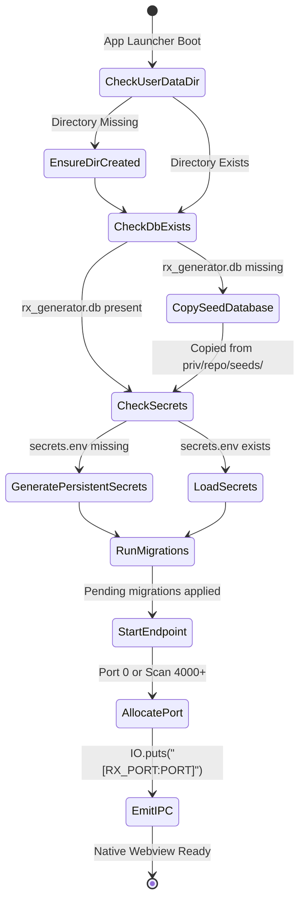

# Data Model & Storage Lifecycle: Desktop Distribution

## Directory Layout & Storage Hierarchy

```
[OS User Profile / Data Directory]
  ├── Windows: %APPDATA%/RxGenerator/
  └── Linux:   ~/.local/share/rx_generator/ (or $XDG_DATA_HOME/rx_generator)
       ├── rx_generator.db           # Working SQLite database (seeded + user vaults + prescriber configs)
       ├── rx_generator.db-wal       # SQLite write-ahead log
       ├── rx_generator.db-shm       # SQLite shared memory index
       ├── secrets.env               # Machine-specific persistent SECRET_KEY_BASE & CLOAK_KEY
       └── logs/                     # Rotation-limited debug and application logs
```

## Release Asset Distribution (`rel/rx_generator`)

```
[Installed Application Bundle] (e.g. C:\Program Files\RxGenerator or /opt/rx_generator)
  ├── bin/
  │    ├── rx_generator              # Unix release control script
  │    ├── rx_generator.bat          # Windows release control script
  │    └── RxGeneratorApp.exe        # Native Windows WebView2 supervisor runner
  ├── erts-XX.X.X/                   # Bundled Erlang Runtime System
  ├── lib/                           # Compiled BEAM bytecode archives
  │    ├── rx_generator-0.1.0/
  │    │    └── priv/
  │    │         ├── repo/seeds/rx_generator_seed.db  # Template DGDA database snapshot
  │    │         └── static/                          # Compiled CSS/JS assets
  │    └── ... (dependencies)
  └── releases/
       ├── 0.1.0/
       │    ├── env.bat / env.sh     # Environment initializer
       │    └── sys.config
```

## Storage Lifecycle & State Machine



## Machine Secret & Key Model

| Key Attribute | Source / Storage | Scope & Invariance |
| :--- | :--- | :--- |
| `DATABASE_PATH` | User Data Directory / `rx_generator.db` | WAL mode enabled, single node local access |
| `SECRET_KEY_BASE` | Generated 64-byte Base64 token in `secrets.env` | Persistent across application restarts |
| `CLOAK_KEY` | Generated 32-byte AES-GCM key in `secrets.env` | Decrypts AshCloak patient PHI attributes |
| `PORT` | Ephemeral port (allocated at runtime) | Bound strictly to `127.0.0.1` |

