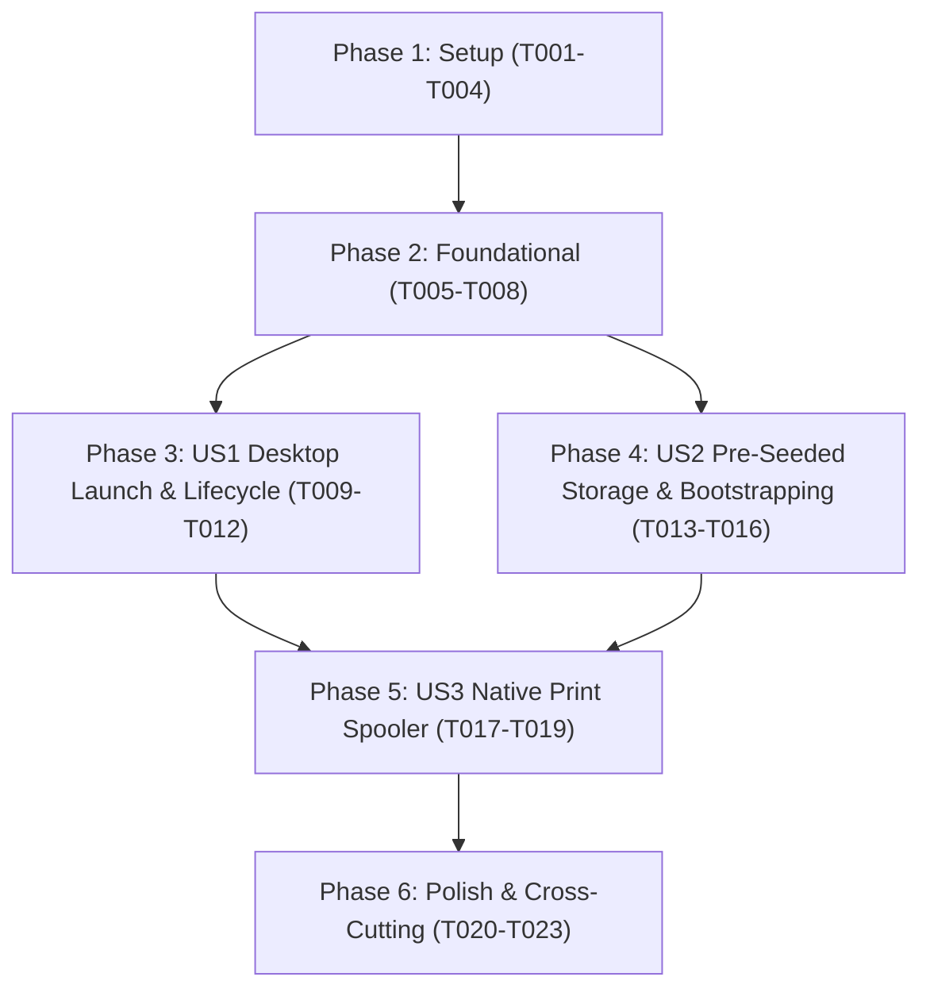

# Tasks: 006 Desktop Packaging & Distribution

**Input**: Design documents from `/specs/006-desktop-packaging-distribution/`
**Prerequisites**: plan.md, spec.md, research.md, data-model.md, contracts/desktop-ipc-contract.md, quickstart.md

## Organization & Rules
- **Strict Test-First Protocol (Constitution)**: All behavioral and unit tests MUST be written and fail before minimal implementation code is written.
- Tasks are grouped by phase and user story to ensure independent testability and incremental delivery.
- Every task includes exact file paths and dependencies.

## Format: `[ID] [P?] [Story] Description`
- **[P]**: Can run in parallel (different files, no dependencies)
- **[Story]**: Which user story the task belongs to (US1, US2, US3)

---

## Phase 1: Setup & Release Infrastructure

**Purpose**: Configure Mix release packaging, runtime overlays, and build scripts.

- [x] T001 Configure Mix release `:rx_generator` in `mix.exs` with `include_erts: true`, stripped binaries, and overlay paths.
- [x] T002 Create Windows release environment script in `rel/env.bat.eex` setting production defaults (`PHX_SERVER=true`).
- [x] T003 [P] Create Unix release environment script in `rel/env.sh.eex` setting production defaults (`PHX_SERVER=true`).
- [x] T004 Create release packaging helper script in `scripts/build_desktop.ps1` to automate `mix assets.deploy`, `mix release`, and runner compilation.

---

## Phase 2: Foundational (Subsystem Prerequisites)

**Purpose**: Dynamic port binding, loopback restriction, and IPC signaling needed by all desktop wrappers.

- [x] T005 Write unit test in `test/rx_generator_web/endpoint_port_test.exs` verifying dynamic loopback port allocation on `127.0.0.1`.
- [x] T006 Update `lib/rx_generator_web/endpoint.ex` and `config/runtime.exs` to support dynamic ephemeral loopback port (`127.0.0.1:0` or open port scan starting at 4000).
- [x] T007 Implement IPC port notifier in `lib/rx_generator_web/listeners/port_notifier.ex` that emits `[RX_PORT:<port>]` to stdout upon server socket binding.
- [x] T008 Add `RxGeneratorWeb.Listeners.PortNotifier` into application supervision tree in `lib/rx_generator/application.ex`.

---

## Phase 3: User Story 1 - Self-Contained Desktop Launch & Lifecycle (Priority: P1) 🎯 MVP

**Goal**: Package the self-contained native window wrapper supervising the BEAM release as a child process with dynamic port discovery, single-instance enforcement, and clean termination.

**Independent Test**: Launch the native runner executable on a target machine without Elixir/Node/Erlang installed; verify native window opens to RxGenerator interface within 3.5 seconds; close window and assert zero orphaned BEAM processes in Task Manager.

### Tests for User Story 1
- [x] T009 Write supervisor runner lifecycle test in `test/rx_generator/desktop_runner_test.exs` testing stdout parsing of `[RX_PORT:<port>]` and child process termination signaling.

### Implementation for User Story 1
- [x] T010 Implement native Windows WebView2 runner in `native_runner/windows/RxGeneratorApp.cs` with:
  - Single instance check via named Mutex `Global\RxGenerator_SingleInstance_App_Mutex`.
  - Windows Job Object configuration with `JOB_OBJECT_LIMIT_KILL_ON_JOB_CLOSE` to ensure child process tree auto-kill on parent exit.
  - Spawning `bin\rx_generator.bat start` with redirected stdout/stderr.
  - Regex parser awaiting `\[RX_PORT:(\d+)\]`.
  - WebView2 control initialization navigating to `http://127.0.0.1:<port>`.
- [x] T011 Create runner compilation script `native_runner/windows/build_runner.ps1` utilizing standard `.NET Framework` `csc.exe`.
- [x] T012 [P] Implement native Linux runner script in `native_runner/linux/rx_generator_runner.sh` with WebKitGTK / shell wrapper and PID trap cleanup.

**Checkpoint**: User Story 1 is functional. The desktop application boots natively without runtime dependencies and terminates cleanly.

---

## Phase 4: User Story 2 - Pre-Seeded Offline Storage & Index Initialization (Priority: P2)

**Goal**: Automatically provision user data directory (`%APPDATA%/RxGenerator` or `~/.local/share/rx_generator`), copy bundled DGDA seed database, generate persistent machine secrets, and execute Ecto/Ash migrations on first boot.

**Independent Test**: Delete `%APPDATA%/RxGenerator`; launch application; verify directory is recreated, database contains full DGDA formulary catalog, and omnibar search returns results in <15ms without network access.

### Tests for User Story 2
- [x] T013 Write integration test in `test/rx_generator/release_bootstrap_test.exs` verifying:
  - Resolution of user data directory based on host OS.
  - Automatic creation of target directory if absent.
  - Atomical copy of template seed SQLite database.
  - Generation and persistence of `SECRET_KEY_BASE` and `CLOAK_KEY` in `secrets.env`.
  - Idempotent execution of Ecto/Ash migrations without modifying existing user prescriber/patient vault data.

### Implementation for User Story 2
- [x] T014 Implement release bootstrapper in `lib/rx_generator/release.ex` with `ensure_user_data_dir/0`, `ensure_database_file/1`, `ensure_secrets/1`, and `run_migrations/0`.
- [x] T015 Generate production seed database snapshot in `priv/repo/seeds/rx_generator_seed.db` containing the pre-indexed DGDA drug catalog.
- [x] T016 Update `config/runtime.exs` and `rel/env.bat.eex` to invoke `RxGenerator.Release.bootstrap/0` prior to starting endpoint.

**Checkpoint**: User Story 2 is functional. Pre-seeded database and local vector indices are automatically provisioned in user profile on initial launch.

---

## Phase 5: User Story 3 - Native OS Print Spooler Integration (Priority: P3)

**Goal**: Bind `window.print()` triggers from the LiveView UI directly to the native host OS print dialog with zero browser chrome and strict High Court formatting.

**Independent Test**: Trigger prescription print in the native desktop window; verify the OS print dialog opens and prints with two-column chamber headers, bold uppercase generic molecule names, and crisp 2D Ed25519 QR barcodes.

### Tests for User Story 3
- [ ] T017 Write LiveView print trigger test in `test/rx_generator_web/live/desktop_print_test.exs` verifying `phx-click="print"` dispatches `window.print()` event with clean `@media print` CSS classes.

### Implementation for User Story 3
- [ ] T018 Refine `@media print` rules in `assets/css/app.css` to enforce:
  - `@page { margin: 10mm; size: auto; }`
  - Suppression of browser headers and footers (`display: none` on URL / timestamp chrome).
  - Explicit contrast and sizing for the 2D QR code barcode SVG container.
- [ ] T019 Configure WebView2 settings in `native_runner/windows/RxGeneratorApp.cs` enabling native print dialog support (`CoreWebView2.ShowPrintUI` or native print interception).

**Checkpoint**: User Story 3 is functional. Prescriptions print cleanly via the native OS print spooler.

---

## Phase 6: Polish & Cross-Cutting Concerns

**Purpose**: RAM ceilings validation, air-gap audit, and end-to-end distribution packaging.

- [ ] T020 Write end-to-end packaging verification test in `test/rx_generator/desktop_packaging_test.exs` asserting release files, erts binaries, and seed database exist in build output.
- [ ] T021 Measure and verify combined RAM usage of BEAM node + WebView2 runner remains under 250MB during active prescription generation.
- [ ] T022 Validate full air-gap execution by running complete test suite with simulated zero network access.
- [ ] T023 Run `mix precommit` and verify zero compiler warnings and 100% test pass.

---

## Dependencies & Execution Order

## Parallel Execution Opportunities
- `T002` (Windows env.bat) and `T003` (Unix env.sh) can run in parallel.
- `T010` (Windows C# runner) and `T012` (Linux runner script) can run in parallel.
- `T017` (Print LiveView test) and `T018` (CSS print rules) can run in parallel.

